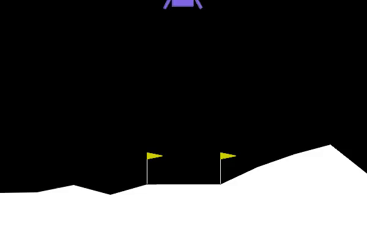
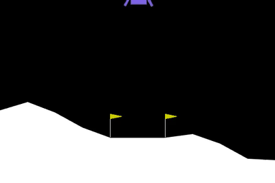
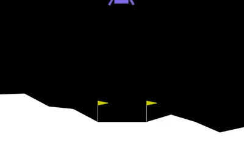

# Lunar Lander: reward shaping and reward hacking

I trained a PPO agent to land a rocket in Gymnasium's `LunarLander-v3`, wrote my own reward rules on top, broke them on purpose, and fixed them. A bonus that pays an AI for *sitting in a good spot* teaches it to sit there forever instead of finishing the job.

Based on the tutorial "Training an AI to land a rocket with reward shaping" by Hari (@harixganesh).

## The three behaviors

| Normal landing | Reward hacked: hovering | The fix |
|---|---|---|
|  |  |  |
| Built-in reward only | +1 per frame while upright and slow | Pay for improvement, plus a small per-frame fee |

Each GIF is one attempt from a seed 0 model, trimmed to the first 12 seconds. The numbers below come from 20 attempts, not from the GIFs.

## Results

Each model is scored on 20 attempts with fixed starting conditions, deterministic actions, and my custom reward turned off. Solved means a mean of 200 or more. A full attempt is capped at 1000 frames.

| Model | Seed | Mean score | Lowest | Attempts under 200 | Mean length (frames) |
|---|---|---|---|---|---|
| Baseline | 0 | 250.4 ± 16.9 | 218.4 | 0 | 387 |
| Baseline | 1 | 259.4 ± 54.4 | 37.9 | 1 | 304 |
| **Hover hack** | 0 | **-25.8 ± 19.8** | -64.0 | **20** | **1000** |
| **Hover hack** | 1 | **-80.3 ± 23.8** | -118.9 | **20** | **1000** |
| Fix | 0 | 237.7 ± 21.6 | 205.6 | 0 | 431 |
| Fix | 1 | 266.0 ± 21.7 | 227.1 | 0 | 311 |
| Time penalty (0.05 per frame) | 0 | 258.0 ± 19.5 | 224.0 | 0 | 344 |

## What happened

**The hack.** The bonus pays +1 for every frame the rocket is upright and slow. Landing ends the attempt, which stops the payments, so staying in the air pays more than landing. The agent learned exactly that. On seed 0, over five checked attempts, it never touched the ground, fired an engine on 99 to 100% of frames, and hovered at a height of 0.67 to 0.95. The baseline's legs are down 11 to 14% of the time and its engines fire 68 to 72% of the time.

The score the agent was chasing is roughly its true score plus the bonus frames. A baseline landing earns about 250 + 348 = 600 that way, while the hover earns about -26 + 963 = 937. The hover really did pay better, so the agent did what it was paid for.

**The fix.** The fix pays on the *change* into the "upright and slow" zone instead of for being in it, plus a small fee every frame. Entering the zone pays once, staying in it pays nothing, so waiting stops being profitable. It lands again on both seeds. The gap to the baseline changes sign between seeds (-12.7 on seed 0, +6.6 on seed 1), so there is no evidence it is better or worse than the baseline.

## The reward rules

All in [`reward_wrapper.py`](reward_wrapper.py). A wrapper sits between the game and PPO, takes the built-in reward, changes it, and passes the total on. The game itself is untouched.

| Wrapper | Rule |
|---|---|
| `TimePenaltyWrapper` | subtract 0.05 every frame |
| `HoverBonusWrapper` | add +1 every frame the rocket is upright and slow |
| `ImprovementBonusWrapper` | add `5 * (0.999 * zone_now - zone_before) - 0.05` every frame |

"Upright and slow" means tilt below 0.2, and sideways and vertical speed each below 0.3 (in the game's normalized units). I picked those thresholds myself.

## Reproduce it

Windows PowerShell, Python 3.11. Tested with gymnasium 1.4.0, stable-baselines3 2.9.0, torch 2.14.1 and box2d 2.3.10.

```powershell
py -3.11 -m venv .venv
.venv\Scripts\Activate.ps1
pip install -r requirements.txt
```

If the Box2D install fails mentioning `swig`, run `pip install swig` first and try again.

```powershell
python train.py                          # baseline, about 20 minutes on a laptop CPU
python train_wrapped.py time_penalty     # step 5 reward
python train_wrapped.py hover_hack       # the deliberate mistake
python train_wrapped.py improvement_fix  # the fix

python train.py 1                        # add a seed to repeat a run
python train_wrapped.py hover_hack 1

python play.py eval models/ppo_hover_hack       # score over 20 fixed attempts
python play.py diagnose models/ppo_hover_hack   # hovering or on the ground?
python play.py watch models/ppo_hover_hack      # watch it fly
python play.py record models/ppo_hover_hack     # save videos to videos/
python make_gifs.py                             # turn videos into GIFs in assets/
```

Models and videos are not in the repo, so you train them yourself. Each model is a 1,000,000 step PPO run with 16 parallel environments and takes about 15 to 20 minutes on a laptop CPU, no GPU needed.

## Limits worth knowing

- Two training seeds only. The pattern repeated, but two runs is a small sample.
- The PPO settings (16 environments, `n_steps=1024`, `gamma=0.999` and so on) are the ones I remember from the Hugging Face Deep RL course for this game. I did not check them against the course page.
- The thresholds, the 0.05 fee, the bonus size and the improvement scale of 5 are my own first guesses and were not tuned.
- During training, the logged `ep_rew_mean` shows the original game score, not the custom reward, because Stable-Baselines3 records it before the wrapper changes it. So the hack does not show up as a rising training curve, only in the evaluation and the clips.
- The seed 1 hover was identified from its 1000 frame length, not checked with `diagnose`.
- The time penalty was run on one seed only, and its small edge over the baseline is within noise.

## Files

| File | What it does |
|---|---|
| `train.py` | train the baseline PPO agent |
| `train_wrapped.py` | train with a custom reward, picked by name |
| `reward_wrapper.py` | the three reward rules |
| `play.py` | eval, diagnose, watch and record |
| `make_gifs.py` | turn recordings into GIFs |
| `random_lander.py` | watch a random pilot crash |
| `project.md` | project notes and progress log |
| `decisions.md` | every decision, with the reasoning |
